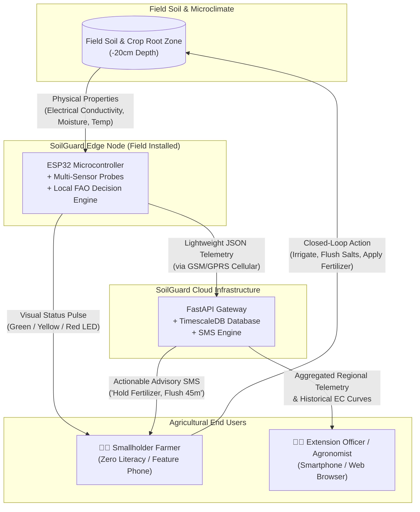
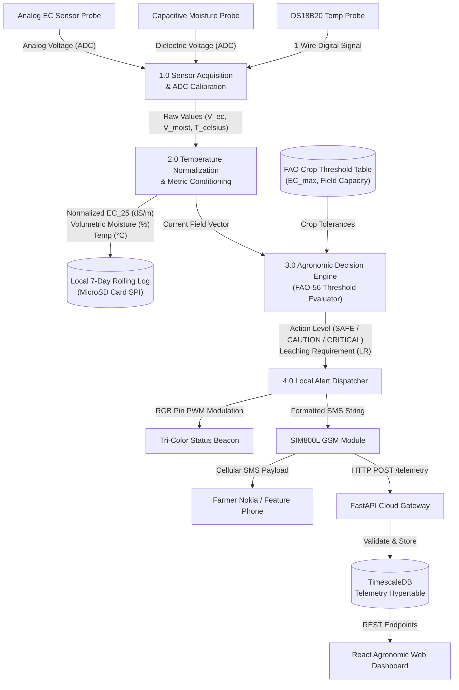

# 🌊 SoilGuard — Data Flow Diagrams (DFD)

This document formalizes the data flow pathways across the **SoilGuard Soil Intelligence System (SIS)** at Level 0 (System Context) and Level 1 (Subsystem Decomposition).

---

## 1. DFD Level 0: System Context Diagram

The Level 0 diagram outlines the boundary between the physical environment, edge sensor hardware, agricultural end users, and the cloud advisory gateway:

---

## 2. DFD Level 1: Subsystem Data Flow Decomposition

The Level 1 diagram breaks down internal data flow transformations from raw sensor ADC voltages to normalized agronomic metrics, local persistence, LED modulation, and cloud analytics:

---

## 3. Data Dictionary

| Data Element | Type | Units | Range | Description |
| :--- | :--- | :--- | :--- | :--- |
| `raw_ec` | Float | dS/m | 0.0 – 20.0 | Measured soil water electrical conductivity before temperature correction. |
| `normalized_ec_25` | Float | dS/m | 0.0 – 20.0 | Electrical conductivity normalized to 25°C baseline using $\alpha = 0.020$/°C. |
| `moisture_vwc` | Float | % VWC | 0.0 – 100.0 | Volumetric Water Content percentage derived from capacitive dielectric frequency. |
| `soil_temp_c` | Float | °C | -10.0 – 65.0 | Soil temperature at -20cm root zone depth measured by DS18B20. |
| `status` | String | Enum | OPTIMAL, IRRIGATE, CAUTION, CRITICAL | Core agronomic state classification. |
| `action` | String | Enum | NONE, WATER_FIELD, PAUSE_WATER, FLUSH_SALTS | Direct physical task commanded to farmer. |
| `allow_fertilizer` | Boolean | Flag | True / False | Chemical lockout preventing fertilizer burn during elevated salinity. |
| `leaching_fraction` | Float | Fraction | 0.05 – 0.45 | Fraction of extra irrigation water required to leach salts below root zone. |
