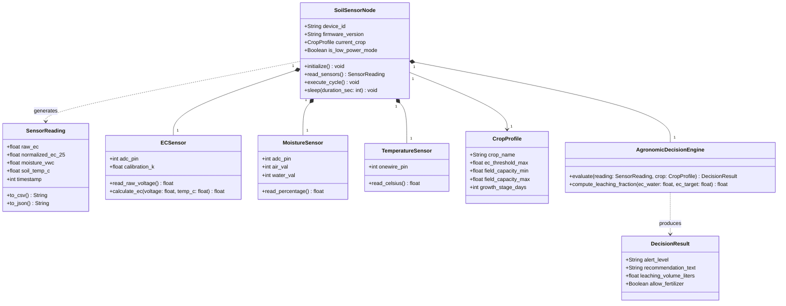
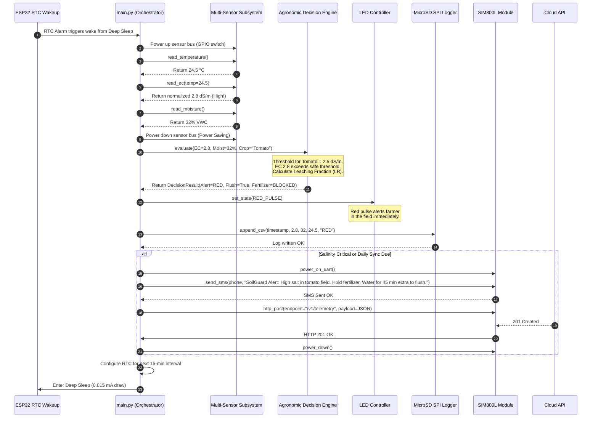
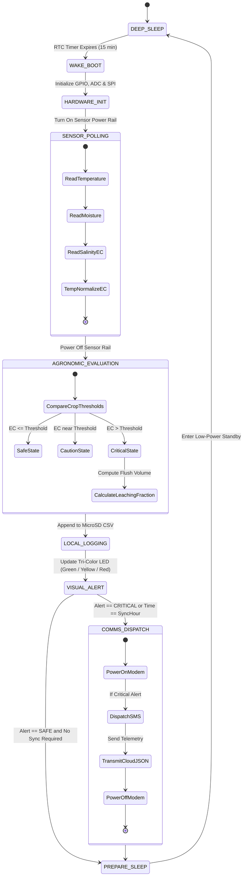
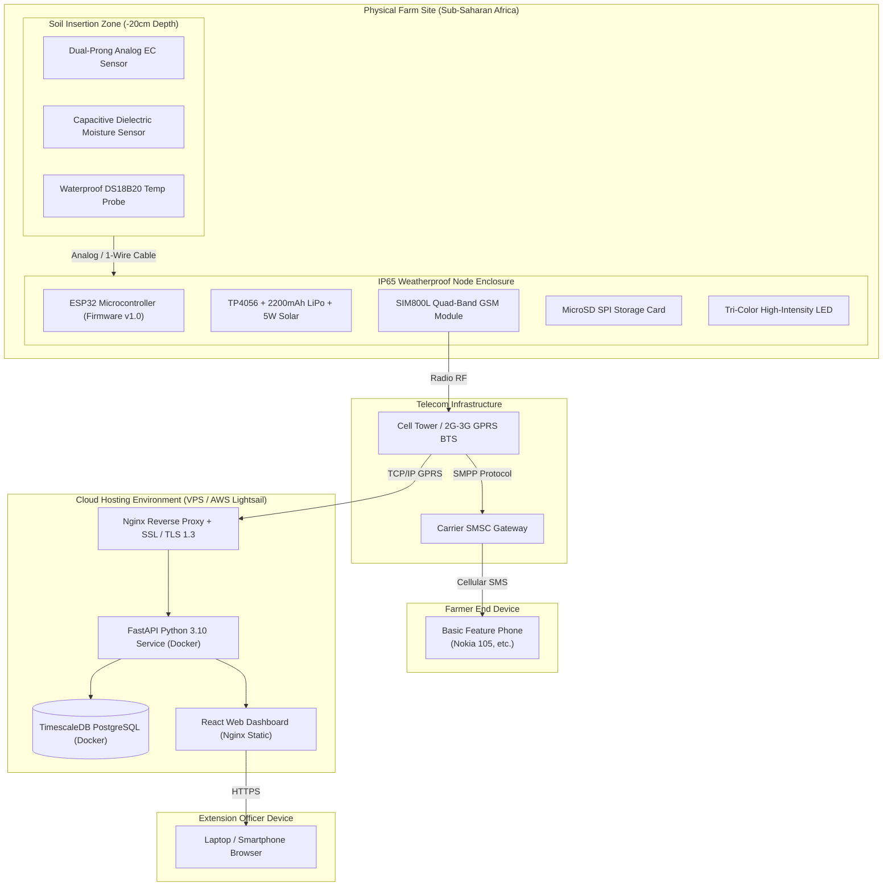

# 📐 SoilGuard — UML Architecture Diagrams

This document contains the complete Unified Modeling Language (UML) specifications for the **SoilGuard Soil Intelligence System (SIS)**.

---

## 1. UML Class Diagram: Domain & Edge Architecture

---

## 2. UML Sequence Diagram: 15-Minute Sensor & Decision Cycle

---

## 3. UML State Machine Diagram: Edge Firmware Lifecycle

---

## 4. UML Deployment Diagram: Physical & Cloud Infrastructure

